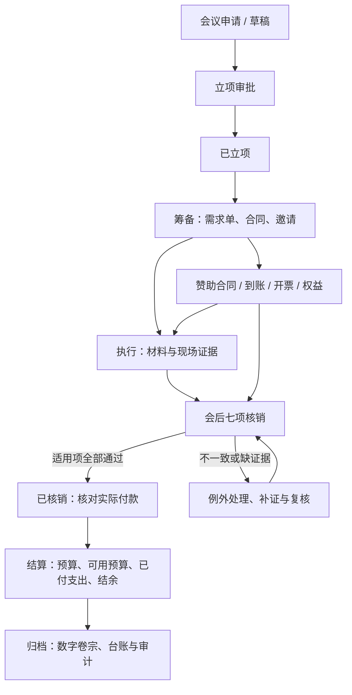

# 会规智云 · 合规会务全流程 ERP

**让每一场会议的立项、合同、收入、执行证据、核销、付款与档案形成一条可追溯的业务链。**

会规智云面向医学会、行业协会、学术组织及其会务执行团队，是以会议项目为核心、以证据核验为基础、以财务闭环为目标的会务管理系统。它将分散在微信群、Excel、合同文件、照片和银行回单中的业务记录组织到同一个会议编号下，让组织管理者、执行人员与财务核销人员在各自权限内协同工作。

> 不只是管理会议，更是管理一场会议从申请到结算的责任、证据和资金流向。

[体验演示版（隔离演示数据）](https://erp.aibuild.work) · [统一发布规范](docs/unified-source-release.md) · [微信小程序](miniprogram/README.md)

## 01 · 产品定位与价值

| 业务痛点 | 会规智云的解决方式 | 业务价值 |
| --- | --- | --- |
| 多协会、多部门、多人交接，资料分散 | 一会一编号、项目化待办、权限与责任分工 | 减少跨部门反复沟通与重复录入 |
| 会议执行后才发现缺合同、缺课件、缺签到证据 | 执行过程中按类别归集原件，核销适用项与证据关联 | 将资料补齐和核验前移，降低返工风险 |
| 赞助收入、合同、发票和付款分开管理 | 赞助合同—到账—开票—权益与支出合同—核销—付款分别关联 | 看清应收、实收、支出与项目结余 |
| 人工从合同、发票、议程逐项抄录 | OCR、PDF 文本层及 Office 文档解析辅助预填和比对 | 减少机械性录入，保留人工判断 |
| 核销不完整或重复付款 | 业务状态门禁、合同金额校验、付款权限及重复检查 | 降低未经核验付款和重复支付风险 |
| 会后需要反复整理审计材料 | 项目台账、归档来源索引、PDF/PPTX 卷宗、审计与受控更正 | 缩短资料调取与复核链路 |

上述价值是产品设计目标，不代表已经测得量化节省比例或通过外部合规认证。

## 02 · 一场会议的完整业务流程



项目状态机明确区分 **草稿 → 待审批 → 已立项 → 筹备中 → 执行中 → 待核销 → 已核销 → 已结算 → 已归档** 九个阶段。每个流转由后端检查当前状态、操作权限与业务条件，前端展示可执行动作及受限原因；不是仅靠页面按钮控制。

### 立项与筹备

- 支持多协会、线上/线下/混合会议、项目负责人、承办部门、初版议程、项目预算和税费管理费率。
- 新会议编号由协会编码、年份和流水号构成；历史编号继续兼容。项目编号贯穿合同、需求、材料、付款、结算和档案。
- 支持立项审批、驳回原因、项目变更与双人复核；审批通过后冻结立项函内容及 Word 模板引用。
- 会务需求单按设计、制作、现场执行、其他四组组织，支持项目需求、单价、数量、金额、确认归档与历史版本。
- 企业及嘉宾邀请支持模板、专属 PDF、邮件及微信分享、邀请响应记录。社会公众活动提案可由管理员处理并转为内部立项草稿。

### 合同与会议收入

三类正式合同统一进入合同台账：**企业赞助合同、会务协议、劳务协议**。合同上传一次即关联会议原件归档；合同状态、签署审批、原件替换、分类调整及受控更正均保留相应业务校验。

企业赞助业务独立记录赞助合同金额、已签署金额、到账金额、开票金额、收入与预算差额，并将赞助权益拆分为可确认的二级事项，关联对应权益照片。收入不因超过项目预算而被硬性拦截；它与项目预算是相关但不同的财务口径。

### 会务执行与材料收集

- Web 和微信小程序使用同一会议数据及后端材料类别目录。
- 支持按类收集立项文件、会议通知、招商函、议程、终版议程、课件、串场、签到表、劳务表、讲者照片、现场照片、会议截图、在线记录、发票、会务发票、权益照片及自定义材料。
- 合同作为独立的正式台账入口，在小程序中可选择类别、上传原件、OCR 预填、核对信息及提交签署；不能借普通材料入口绕过合同规则。
- 支持拍照、相册和微信会话文件，普通材料单批最多 10 份，单份上传上限 50 MB；终版议程按版本管理，讲者照片支持按姓名关联，权益照片关联具体赞助权益。
- 已登记文件可按权限查看或纠错；软删除、废件箱恢复与合同/核销关联保护由后端处理。

## 03 · 核心差异：七项证据核销

核销不是简单的审批勾选，而是将会议实际证据与合同、费用及议程进行有条件的核验。前四项必核，第五至七项根据实际业务启用，适用项可独立办理，无须强制按序逐项操作。

| 项次 | 核销内容 | 主要证据与判断 |
| --- | --- | --- |
| 1 | 盖章函件与串场核验 | 当前终版议程、串场、盖章函件的会议名称、时间与主办方 |
| 2 | 讲者名单信息一致 | 讲者照片文件名对应姓名与终版议程名单关联 |
| 3 | 参会数据与时长 | 在线时长证据、签到原件及会议形式；按当前规则核验 |
| 4 | 课件主题在终版议程里 | 课件或演示课件封面主题与终版议程比对 |
| 5 | 劳务表五字段核验（按需） | 有劳务表时逐人核对五字段，并匹配劳务专家合同 |
| 6 | 会务合同与发票关联核对（按需） | 有会务需求单时核对需求预算与已签会务合同总额，并关联发票原件；不校验发票金额 |
| 7 | 赞助权益核对（按需） | 赞助合同权益明细与权益照片逐项人工确认 |

OCR 可以辅助提取会议议程、人员、课件主题、时长、劳务信息、合同签约方及金额、发票和回单字段。识别结果需要人工核对，不能代替原件、签署审批或核销结论。异常事项进入例外处理及复核流程，未完成适用项、证据不足或存在未关闭例外时不得核销通过。

规则源代码：[核销常量](server/lib/constants.js) · [状态机与门禁](server/lib/workflow.js) · [核销 API](server/api/verify.js) · [OCR 引擎](server/lib/ocr-engine.js)。

## 04 · 财务闭环：收入、付款与结算

**项目预算不等于实际赞助到账金额；可用预算也不等于已付款金额。** 系统分别记录预算、税费管理费、赞助到账、开票、已签署支出合同与实际付款，避免不同口径混用。

- 收入端：赞助合同、签署、到账凭证、开票、权益及差额对照。
- 付款端：按权限列出已核销会议，从核验后的合同/劳务资料关联收款方、金额及原件。财务在线下实际付款后可逐笔确认「已付款」，付款凭证可单独补传；历史审批付款流程仍兼容。
- 允许超项目预算或可用预算付款，并保留超支审计记录；生产环境仍执行核销、已签署支出合同累计金额、个人劳务金额、项目范围、重复付款和冻结状态等约束。
- 结算前须完成适用核销项、处理未完成付款；生产环境还检查实际已付款总额与核销支出合同总额的对应关系。系统登记付款事实，不接入银行自动转账，也不等同于银行支付成功证明。

结算总览统一列为：结算单号、项目、项目预算、可用预算、已付支出、结余、生成人、时间、操作。

```text
可用预算 = 项目预算 × (1 − 税费管理费率)
结余     = 可用预算 − 已付支出
```

金额以分为精度。例如预算 100,000 元、税费管理费率 10%、已付支出 95,000 元，可用预算为 90,000 元，结余为 −5,000 元（超支）。原预算不会随付款自动改写。新结算单保存费率快照，历史无费率快照时兼容项目费率。

结算详情按劳务、会务、协会报销、其他四类展开已付款明细。结算生成后冻结业务账目与核销结论，特殊纠错走授权更正及审计。系统区分日常业务限制与总管理员的受控修订能力。

## 05 · 数字档案与组织治理

- **一会一档：** 通过会议编号关联原始业务表，项目台账展示合同、付款、结算、材料与审批，并提示对账差异，不另造一套财务账。
- **归档输出：** 从已归档会议的业务来源自动归集材料，支持选取资料、按既定类别组织、PDF/PPTX 导出、原始文件 ZIP 下载（仅所选已留存原件，不转换、不加水印）、付款对照表、默认操作员及时间水印（PDF）；部分 Office 格式依赖服务端转换能力。
- **多协会权限：** 总管理员管理组织及用户，其他账号按模块、动作和项目范围授权；参与者接口裁剪不应公开的业务字段。小程序与 Web 使用同一服务端权限模型。
- **追溯与修订：** 关键操作留审计记录，支持合同更正版本、材料软删/恢复及总管理员受控内容修订；保护签署、核销与结算的关联状态。

## 06 · 使用端与技术架构

| 端 | 定位 |
| --- | --- |
| Web 管理工作台 | 项目、需求、合同、收入、核销、付款、结算、档案、组织权限与审计 |
| 微信小程序 | 授权用户的项目/申请、审批、材料及合同上传、核销查看、邀请响应、账号管理 |
| 服务端 API | 统一状态机、权限校验、项目范围、财务规则与证据存储 |

技术栈：Node.js 22.5+、SQLite、原生 ES Module SPA、微信原生小程序。文档生成使用 pdf-lib、docxtemplater 和 PizZip；服务端 OCR 使用 RapidOCR / ONNX Runtime CPU 与 PDF 文本层解析，依赖相应部署配置，未启用时保留人工录入。

## 07 · 部署与代码治理

**main 是唯一正式代码源。** 项目进入维护阶段，不再维护长期测试或生产业务代码分支；历史分支是否完成清理不影响正式代码来源。短期修复如需工作分支，合并后清理；发布和回滚以审查通过的提交 SHA 记录。

| 环境 | 用途 | 运行约束 |
| --- | --- | --- |
| Cloudflare 演示（erp.aibuild.work） | 产品体验 | ERP_DEMO_MODE=1，隔离演示账号及数据；经专用发布流程更新 |
| 阿里云 ECS 测试 | 功能及部署验收 | 独立数据库、文件目录、测试 SMS 和服务；禁止真实客户数据 |
| 阿里云 ECS 生产 | 正式业务 | HTTPS、持久化 SQLite、独立附件存储、真实短信与生产密钥 |
| 微信小程序 | 移动业务入口 | 同一 main 源码，正式 API 指向 ECS；需 AppID、审核及独立发布 |
| Vercel | 临时演示适配 | 不承担生产数据库或真实业务 |

生产发布必须先在测试环境验收同一个完整 Git SHA，使用部署脚本预检、备份数据库及附件，再执行生产更新。Cloudflare 禁止生产模式；旧 cf:deploy 命令不能绕过生产门禁。正式账号采取白名单及身份认证，生产短信支持阿里云（默认）与腾讯云（兼容）。首次初始化需要明确指定总管理员账号；正式环境配置与密钥必须独立管理。

代码完成、真实环境验收、生产发布与微信审核是不同事项。本 README 基于 main 的静态代码审阅更新，未据此宣称生产环境或微信审核已完成，也不构成法律、财务或合规认证。

部署详见 [生产指南](docs/production-deployment.md)、[测试环境](docs/test-deployment.md)、[统一发布规范](docs/unified-source-release.md)、[Cloudflare 约束](docs/cloudflare-secure-deployment.md)、[小程序说明](miniprogram/README.md)。

## 08 · 开发与质量验证

```bash
npm install
npm test
npm run test:cf
npm run cf:build  # Worker 构建检查，不发布
```

在已配置生产环境变量的 ECS 上运行 `npm run prod:check` 进行上线预检。脚本与测试入口详见 `package.json`；执行测试或预检不代表业务验收已完成。

| 目录 | 用途 |
| --- | --- |
| server/ | 后端 API、状态机、权限、财务、核销、OCR、文档与存储 |
| web/ | Web 管理工作台 |
| miniprogram/ | 微信小程序客户端 |
| worker/、api/ | 隔离演示适配层 |
| deploy/aliyun/ | ECS 部署、systemd、Nginx 及环境模板 |
| scripts/、test/ | 部署预检、业务与兼容性回归测试 |
| docs/ | 业务规则、设计与交付规范 |

---

**会规智云：让会务执行有流程、核销有证据、付款有依据、档案可追溯。**

仓库及程序标识 `erp-workbanch`、`assoc-meeting-erp` 仅用于技术兼容；统一对外品牌为「会规智云」。
